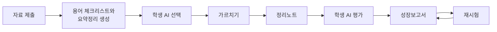
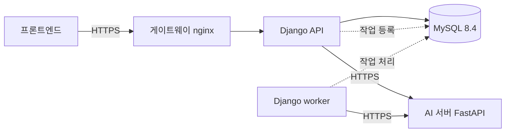

# 티칭로그 Backend

> AI 학생을 가르치며 내 이해의 빈틈을 찾는 학습 서비스, **티칭로그**의 백엔드 API 서버입니다.
>
> 1호선톤 · 팀 1타강사

## 티칭로그는

AI에게 답을 묻는 대신, **사용자가 선생님이 되어 AI 학생을 가르칩니다.** AI 학생은 사용자가 가르친 내용만 알고, 그 내용만으로 시험을 봅니다. 그래서 AI 학생의 점수는 곧 내 설명 실력이고, 틀린 문제는 곧 내 이해의 빈틈입니다.

| 학습의 어려움 | 티칭로그의 해결 |
| --- | --- |
| 읽으면 아는 것 같지만 설명하려면 막힌다 | AI 학생에게 직접 설명하면서 막히는 지점이 드러난다 |
| 무엇을 모르는지 모른다 | 설명하지 않은 용어와 AI 학생이 틀린 문제가 놓친 개념으로 남는다 |
| AI가 생각을 대신해 준다 | AI 학생은 답을 알려 주지 않고, 사용자가 원할 때만 질문한다 |
| 성장이 보이지 않는다 | 성장보고서의 복습 추천과 재시험으로 이전 점수와 비교한다 |

## 서비스 흐름



## 백엔드가 하는 일

- **로그인과 회원 관리:** 구글 로그인, JWT 인증과 토큰 재발급, 회원 탈퇴 시 모든 학습 기록 삭제
- **학습 자료 정리:** PDF, PPT, DOCX, 이미지, 소스코드, 텍스트를 받아 용어 체크리스트와 요약정리를 만들고, 끝나면 **원본을 삭제**
- **실시간 수업:** 설명할 때마다 용어 체크리스트를 판정하고, 학생 AI의 손 든 표시와 질문을 관리
- **수업 뒤 자동 처리:** 정리노트 작성 → 평가 출제 → 학생 AI 풀이 → 채점 → 성장보고서 작성
- **재시험:** 놓친 개념 중심으로 새 문제를 내고, 객관식은 서버가, 주관식은 AI가 채점

### 설계에서 지킨 것

| 원칙 | 구현 |
| --- | --- |
| 학생 AI는 배운 것만 안다 | 학생 역할의 AI 요청에는 대화 내용만 넣고, 원본 자료·요약정리·용어 정의·정답을 넣지 않음 |
| 오래 걸리는 작업은 기다리게 하지 않는다 | `202`를 바로 돌려주고 DB 큐와 별도 worker가 처리. 서버를 재시작해도 대기 중인 작업이 남음 |
| AI가 실패해도 데이터가 어긋나지 않는다 | 실시간 호출은 30초, 백그라운드 호출은 180초에 한 번 재시도. 응답 모양을 검사하고, AI를 기다리는 동안에는 DB 트랜잭션을 열지 않음 |
| 저장은 최소로 | 놓친 개념과 점수 비교는 저장하지 않고 조회할 때 계산 |

## 시스템 구성



| 구분 | 기술 |
| --- | --- |
| 언어·프레임워크 | Python 3.12 이상, Django 6.1, Django REST Framework |
| 인증 | 구글 ID 토큰 검증, Simple JWT |
| DB | MySQL 8.4 LTS |
| 백그라운드 작업 | Django Tasks + `django-tasks-db` (DB 큐) |
| 문서 변환 | LibreOffice (PPT·DOCX → PDF) |
| 배포 | Gunicorn, nginx, GitHub Actions |

```text
.
├── accounts/    # 구글 로그인, JWT, 내 정보, 회원 탈퇴
├── personas/    # 학생 AI 페르소나
├── materials/   # 자료 업로드, 문서 변환, 자료 정리 작업
├── lessons/     # 수업, 대화, 손 든 표시, 수업 종료 처리, 정리노트
├── exams/       # 평가, 재시험, 성장보고서
├── common/      # 공통 에러, 요청 ID, 권한, 페이지, AI 호출, 작업 큐
└── line1_thon/  # 프로젝트 설정
```

## API

`Authorization: Bearer <access_token>`으로 인증합니다. 로그인과 토큰 재발급만 토큰 없이 부릅니다.

**계정**

| Method | 경로 | 설명 |
| --- | --- | --- |
| `POST` | `/api/auth/google` | 구글 로그인·회원가입 |
| `POST` | `/api/auth/refresh` | 토큰 재발급 |
| `POST` | `/api/auth/logout` | 로그아웃 |
| `GET` | `/api/users/me` | 내 정보 |
| `PATCH` | `/api/users/me` | 닉네임 저장, 온보딩 완료 |
| `DELETE` | `/api/users/me` | 회원 탈퇴 |

**자료**

| Method | 경로 | 설명 | 응답 |
| --- | --- | --- | --- |
| `GET` | `/api/personas` | 페르소나 목록 | 바로 |
| `POST` | `/api/materials` | 학습 자료 업로드 | `202` 백그라운드 |
| `GET` | `/api/materials/{material_id}` | 자료 정리 상태 | 바로 |

**수업**

| Method | 경로 | 설명 | 응답 |
| --- | --- | --- | --- |
| `POST` | `/api/lessons` | 수업 시작 | 바로 |
| `GET` | `/api/lessons` | 학습 목록 | 바로 |
| `GET` | `/api/lessons/{lesson_id}` | 수업 정보, 용어 체크리스트 | 바로 |
| `GET` | `/api/lessons/{lesson_id}/messages` | 수업 대화, 손 든 표시 | 바로 |
| `POST` | `/api/lessons/{lesson_id}/messages` | 설명·답변 보내기 | 실시간 AI |
| `POST` | `/api/lessons/{lesson_id}/hand-raises/{hand_raise_id}/ask` | 질문 받기 | 실시간 AI |
| `POST` | `/api/lessons/{lesson_id}/end` | 수업 종료 | `202` 백그라운드 |
| `GET` | `/api/lessons/{lesson_id}/progress` | 수업 뒤 처리 진행 상태 | 바로 |
| `GET` | `/api/lessons/{lesson_id}/note` | 정리노트 | 바로 |

**성장보고서와 재시험**

| Method | 경로 | 설명 | 응답 |
| --- | --- | --- | --- |
| `GET` | `/api/reports` | 성장보고서 목록 | 바로 |
| `GET` | `/api/reports/{report_id}` | 성장보고서 상세 | 바로 |
| `POST` | `/api/reports/{report_id}/retests` | 재시험 출제 | `202` 백그라운드 |
| `GET` | `/api/retests/{retest_id}` | 재시험 문제·상태 | 바로 |
| `POST` | `/api/retests/{retest_id}/questions/{number}/answer` | 문제 풀이와 채점 | 객관식 바로, 주관식 실시간 AI |
| `POST` | `/api/retests/{retest_id}/complete` | 재시험 결과 저장 | 바로 |

에러는 모두 같은 모양이고, 같은 값이 응답 헤더 `X-Request-ID`에도 들어 있습니다.

```json
{
  "error": {
    "code": "NOT_FOUND",
    "message": "수업을 찾을 수 없어요.",
    "request_id": "1f0c2c7e-7a3a-4b5e-9d55-2a1f3c0f9b11"
  }
}
```

목록 API는 `?page=1&size=20`을 받고 `{ "items", "page", "size", "total" }`을 돌려줍니다.

## 시작하기

### 준비물

| 무엇 | 비고 |
| --- | --- |
| Python 3.12 이상 | |
| [uv](https://docs.astral.sh/uv/) | 가상환경과 패키지 설치 |
| MySQL 8.4 | worker가 `SKIP LOCKED`를 쓰므로 8.0 이상 필요 |
| LibreOffice | PPT·DOCX를 올릴 때만 필요 |

macOS에서는 `mysqlclient`를 빌드하려면 다음이 필요합니다.

```bash
brew install mysql-client pkg-config
```

```bash
export PKG_CONFIG_PATH="$(brew --prefix mysql-client)/lib/pkgconfig"
```

### 1. 설치

```bash
git clone https://github.com/LikeLion-No-1-tutor/BE.git
```

```bash
cd BE
```

```bash
uv venv --python 3.12
```

```bash
uv pip install -r requirements.txt
```

### 2. 데이터베이스 만들기

MySQL에 접속해 실행합니다. `test_line1_thon`은 테스트가 쓰는 DB입니다.

```sql
CREATE DATABASE line1_thon CHARACTER SET utf8mb4;
CREATE USER 'line1_thon'@'%' IDENTIFIED BY '<비밀번호>';
GRANT ALL PRIVILEGES ON line1_thon.* TO 'line1_thon'@'%';
GRANT ALL PRIVILEGES ON test_line1_thon.* TO 'line1_thon'@'%';
```

### 3. 환경 변수

```bash
cp .env.example .env
```

`.env`를 열어 값을 채웁니다.

| 변수 | 필수 | 설명 |
| --- | --- | --- |
| `SECRET_KEY` | 예 | Django 비밀 키 |
| `DEBUG` | 예 | 로컬은 `True`, 운영은 `False` |
| `DB_ENGINE`, `DB_NAME`, `DB_USER`, `DB_PASSWORD`, `DB_HOST`, `DB_PORT` | 예 | 2단계에서 만든 DB 접속 정보 |
| `GOOGLE_CLIENT_ID` | 예 | 구글 웹 클라이언트 ID. 프론트엔드와 같은 값 |
| `AI_SERVER_URL`, `AI_SERVER_TOKEN` | AI 기능 사용 시 | AI 서버 주소와 내부 인증 토큰 |
| `CORS_ALLOWED_ORIGINS` | 프론트엔드 연결 시 | 프론트엔드 주소. 쉼표로 구분, 끝에 `/` 없이. 예) `http://localhost:5173` |
| `ALLOWED_HOSTS` | 운영 | 받아 줄 도메인. 쉼표로 구분 |
| `MAX_UPLOAD_MB` | | 업로드 크기 제한. 기본 20 |
| `TEMP_UPLOAD_DIR` | | 업로드 원본 임시 폴더 |
| `LIBREOFFICE_PATH` | | LibreOffice 실행 파일. 기본 `soffice` |
| `EXAM_QUESTION_COUNT` | | 시험 문제 수. 기본 10 |
| `DB_SSL_CA`, `DB_SSL_CERT`, `DB_SSL_KEY` | | 운영 DB 인증서 접속. 로컬은 비워 둠 |

### 4. 실행

```bash
uv run python manage.py migrate
```

```bash
uv run python manage.py runserver
```

자료 정리, 수업 종료 처리, 재시험 출제는 worker가 처리합니다. 터미널을 하나 더 열어 실행합니다.

```bash
uv run python manage.py db_worker
```

서버는 `http://127.0.0.1:8000`에서 열립니다.

## 테스트

MySQL이 켜져 있어야 합니다. AI 서버는 테스트 안에서 가짜 응답으로 대신합니다.

```bash
uv run python manage.py test
```

## 협업

- `main`은 배포되는 코드, `dev`는 다음 배포를 모으는 브랜치입니다.
- 이슈를 만들고, 작업 브랜치에서 `dev`로 PR을 보냅니다.
- `main`에 머지되면 GitHub Actions가 서버에 자동으로 배포합니다.

## 관련 저장소

| 저장소 | 역할 |
| --- | --- |
| [FE](https://github.com/LikeLion-No-1-tutor/FE) | 프론트엔드 |
| [AI](https://github.com/LikeLion-No-1-tutor/AI) | AI 서버 |
